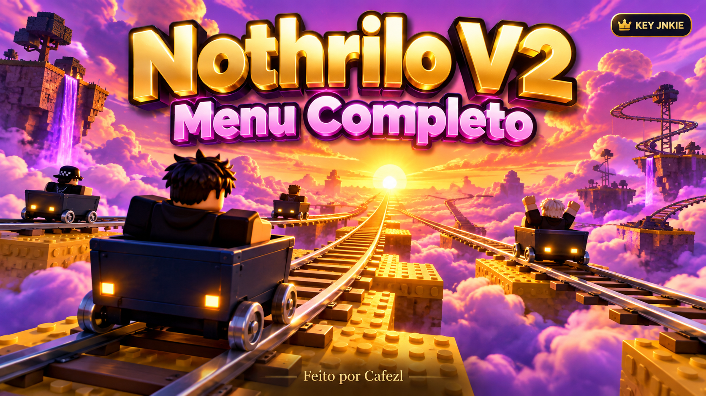
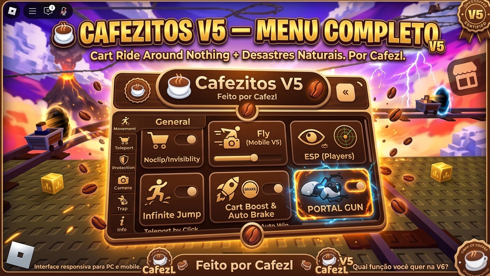

# 🇧🇷 Nothrilo V2 & Cafezitos



<p align="center">
  <strong>Nothrilo V2</strong> · key pelo JNKIE + Linkvertise · menu completo<br>
  <strong>Cafezitos V5</strong> · nova capa · publicação em preparação
</p>

Menus em Luau para **Cart Ride Around Nothing**, criados e mantidos por **Cafezl**.

## Nothrilo V2

O **Nothrilo V2** possui tela de carregamento, sistema de key pelo JNKIE e menu completo com funções para jogador, carrinho, teleporte, ESP e interface.

```lua
loadstring(game:HttpGet("https://api.jnkie.com/api/v1/luascripts/public/500cf49497956113c8fecf4df89e45df90c17c72f7ca25b13eebac9e39881937/download"))()
```

### Como obter a key

1. Execute o código acima.
2. Clique em **GERAR LINK LINKVERTISE**.
3. Abra o link e conclua as etapas.
4. Copie a key fornecida pelo JNKIE.
5. Volte ao menu, cole a key e clique em validar.

Link configurado: [jnkie.com/get-key/nothrilov2](https://jnkie.com/get-key/nothrilov2)
[](https://scriptblox.com/script/cart-ride-around-nothing-Nothrilo-V2-Menu-Completo-227892)
## Cafezitos



O **Cafezitos V5** é um menu separado, com tema próprio. O carregador desta versão ainda não está publicado neste repositório; o link será adicionado quando a publicação estiver pronta.

[Ver Cafezitos no ScriptBlox](https://scriptblox.com/script/cart-ride-around-nothing-Cafezitos-V2-Menu-Completo-224909)

## Versões disponíveis

| Menu | Acesso | Arquivo público |
| --- | --- | --- |
| **Nothrilo V2** | JNKIE + Linkvertise | `nothrilov2/nothrilov2` |
| **Cafezitos V5** | Publicação em preparação | Link será adicionado |

## Recursos do Nothrilo V2

- voo do jogador e do carrinho;
- ESP de jogadores;
- velocidade e pulo infinito;
- anti-AFK;
- teleporte para início, carrinho, checkpoints e sala secreta;
- boost, estabilizador, anti-flip e freio automático;
- noclip, gravidade e transparência;
- posição salva e teleporte por clique;
- busca de partes do mapa;
- câmera livre e spectate;
- recursos de perseguição e teleporte;
- interface ajustável, minimizável e compatível com diferentes telas.

### Atalhos principais

| Tecla | Função |
| --- | --- |
| `V` | Voo |
| `L` | ESP |
| `P` | Pulo infinito |
| `T` | Teleporte por clique |
| `B` | Boost |
| `1`, `2` e `3` | Checkpoints |
| `K` | Minimizar |
| `X` | Fechar |

## Organização do repositório

```text
cart-ride-nothing-around
├── .github/workflows/   # validação automática
├── assets/              # capa e recursos visuais
├── docs/                # documentação complementar
├── INSPIRAÇÃO/          # referências usadas no desenvolvimento
├── nothrilov2/          # carregador público do Nothrilo V2
├── scripts/             # ferramentas de manutenção
└── tests/               # verificações automáticas
```

O arquivo `nothrilov2/nothrilov2` é o carregador público do código mantido no JNKIE. O código do Cafezitos não fica neste repositório.

As cópias antigas e os arquivos de diagnóstico foram removidos. Eles não são mais necessários para executar os menus.

## Verificações

```bash
pnpm test
pnpm run test:luau
```

O GitHub Actions verifica:

- os arquivos públicos existentes;
- a sintaxe dos carregadores;
- o endereço oficial do código no JNKIE;
- a compilação Luau;
- possíveis arquivos truncados ou conteúdo inválido.

## Créditos

**Cafezl** · criador e mantenedor do Nothrilo V2 e Cafezitos.

Projeto independente, sem afiliação com Roblox ou com os criadores de Cart Ride Around Nothing.
